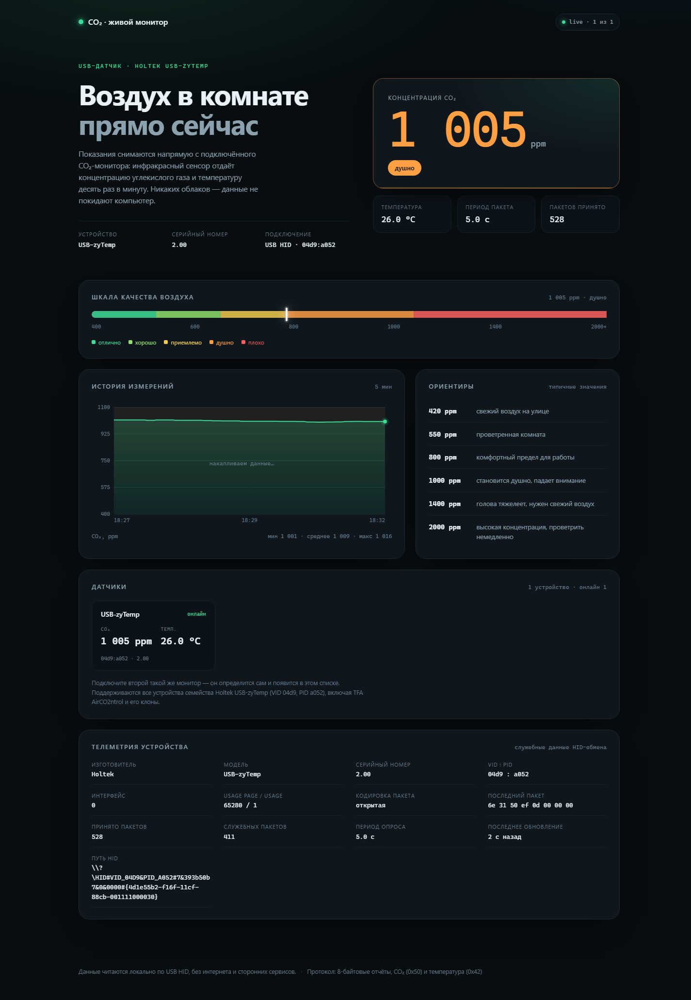

# CO₂ · живой монитор воздуха

Сайт-визитка с живыми показаниями USB CO₂-датчика. Поддерживает два режима:
сервер может читать датчик напрямую или принимать показания от удалённого
агента на другом компьютере.




## Что показывает

- **CO₂** — концентрация в ppm, крупная цифра и статус (отлично / хорошо /
  приемлемо / душно / плохо);
- **Температуру** — в °C, из того же пакета;
- **Шкалу качества** 400–2000 ppm с подвижным маркером;
- **Историю** за последние 10 минут — график на canvas без библиотек;
- **Ориентиры** — типичные значения CO₂ и что они означают;
- **Все найденные датчики** — список с состоянием связи;
- **Телеметрию HID** — VID:PID, серийный номер, путь устройства, период
  пакета, последний пакет в hex, счётчики, кодировку.

## Запуск

```powershell
cd C:\Users\korni\Downloads\nsk_eco\co2_site
.\run.ps1
```

Скрипт сам создаст `.venv`, поставит зависимости и поднимет сервер.
Откройте http://127.0.0.1:8100

Другой порт: `.\run.ps1 -Port 8200`

Если политика PowerShell не даёт запустить скрипт:

```powershell
powershell -ExecutionPolicy Bypass -File .\run.ps1
```

Вручную:

```powershell
python -m venv .venv
.\.venv\Scripts\python.exe -m pip install -r requirements.txt
.\.venv\Scripts\python.exe -m uvicorn server:app --host 127.0.0.1 --port 8100
```

## Датчик

Поддерживаются устройства семейства **Holtek USB-zyTemp** — `VID 04d9`,
`PID a052`. Это OEM-плата, которую используют TFA AirCO2ntrol и её клоны.
Устройство работает как HID, а не как COM-порт, поэтому в диспетчере устройств
оно выглядит как «USB-устройство ввода».

Протокол: 8-байтовые HID-отчёты.

```
[код] [старший байт] [младший байт] [сумма] [0x0D] [0] [0] [0]
```

- `0x50` — CO₂ в ppm;
- `0x42` — температура в 1/16 кельвина (`value * 0.0625 - 273.15`);
- `сумма` — младший байт суммы первых трёх байт.

Оригинальные TFA шифруют пакеты «магической таблицей»; сервер пробует оба
варианта и сам определяет кодировку — в интерфейсе она видна в телеметрии.

Несколько датчиков можно подключить одновременно: поиск новых устройств
выполняется каждые 4 секунды.

## API

| Метод | Адрес | Что отдаёт |
|---|---|---|
| `GET` | `/` | страница |
| `GET` | `/api/state` | полный снимок: датчики, значения, история |
| `GET` | `/api/stream` | SSE-поток того же снимка раз в секунду |
| `GET` | `/healthz` | `{ok, sensors, online}` |
| `POST` | `/api/remote/reading` | показание от удалённого агента |
| `GET` | `/remote_agent.py` | скачать Python-агент |
| `GET` | `/start_agent.bat` | скачать запускатель для Windows |

## Удалённый датчик

Если USB-датчик подключён к другому компьютеру, запустите на нём
`remote_agent.py`. Агент читает HID-пакеты локально и отправляет показания на
сервер по HTTPS. В интернет передаются только измерения и технические данные
датчика, сам USB-доступ наружу не открывается.

### Запуск агента на компьютере с датчиком

Для Windows выполните два действия:

1. Скачайте [start_agent.bat](https://eco.curxtor.ru/co2/start_agent.bat).
2. Откройте скачанный файл двойным щелчком.

При первом запуске скрипт скачает агент, установит HID-зависимость, попробует
определить примерные координаты по публичному IP и предложит их подтвердить или
ввести вручную. Затем он запустит передачу. Нужно заранее установить Python 3
с включённой опцией добавления в PATH. Оставьте окно открытым; остановка — Ctrl+C.
IP-геолокация приблизительная; точный адрес компьютера не передаётся.

Вручную (Windows, Linux или macOS): скачайте
[remote_agent.py](https://eco.curxtor.ru/co2/remote_agent.py), затем установите
зависимость:

```bash
python -m venv .venv
python -m pip install hidapi
```

Проверьте найденные устройства:

```bash
python remote_agent.py --list
```

Запустите отправку показаний (токен не нужен):

```bash
python remote_agent.py \
  --url https://eco.curxtor.ru/co2
```

Агент отправляет данные примерно раз в секунду. Если связь пропадёт более чем
на 20 секунд, датчик будет отмечен на сайте как отключённый.

## Структура

```
co2_site/
├── server.py          чтение HID, протокол, API, SSE
├── static/
│   ├── index.html     разметка страницы
│   ├── styles.css     оформление, адаптив
│   └── app.js         отрисовка данных и график на canvas
├── requirements.txt
├── run.ps1
└── README.md
```

## Ограничения

- Для удалённого режима компьютер с датчиком должен иметь исходящий HTTPS-доступ
  к `eco.curxtor.ru`.
- Endpoint приёма данных публичный и не требует токена. Любой пользователь
  интернета может отправлять синтетические показания.
- Одновременный доступ к HID из другого процесса может конфликтовать.
